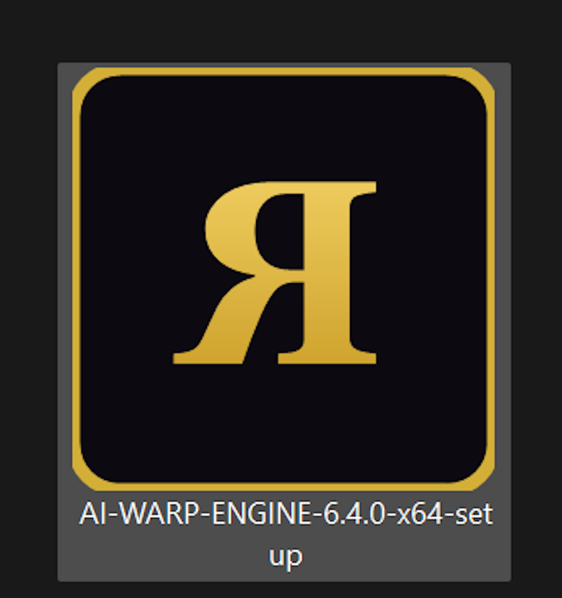

# ⚡ AI WARP ENGINE — Windows App (R3 Canvas Edition v6.4)

<p align="center">
  
</p>

A public-domain glitch visual synthesizer and audio-reactive media playground, packaged as a standalone Windows app with a one-click installer.

**Status: Complete · Ready** (v6.4.6) — download the latest installer from the [Releases page](https://github.com/TheImortalimp/AI-WARP-ENGINE/releases/latest).

## Install

1. Download `AI-WARP-ENGINE-6.4.6-x64-setup.exe` from the latest release.
2. Run it, accept the licence terms, and finish the wizard. No admin rights are needed.
3. The app installs to `Desktop\AI WARP ENGINE`, with a launcher shortcut, a Start Menu entry and an uninstaller.

Requires Windows 10/11 x64 with the Microsoft Edge WebView2 runtime (included with current Windows). The .NET runtime is bundled, so nothing else needs installing. The installer is about 64 MB.

## What it does

AI WARP ENGINE takes a live source and runs it through a real-time Canvas effects pipeline:

- **Sources:** built-in generative visuals, local image / video / audio files, YouTube (playlist or URL), a shared tab / window / screen (display capture), and microphone audio.
- **Effects:** 34 glitch voices, 29 AI Warp modes, Ghost Protocol R3 and V-Sync R3 overlays.
- **Audio reactivity:** a bass / mid / treble / drive analyser (from the mic, the playing audio or the canvas itself) drives the warps, voices and overlays.
- **Automation:** Auto Glitch, Continual Random, Automated Masters, Timed Automation, Wired mode, Soft-Eye and Crescendo.
- **Presets:** 80 machine presets and your own saved user presets, with smooth cross-fades between them.

## Features

### 34 glitch voices

Each voice has its own on/off, level, size and depth.

- **17 core voices:** Neon Grad, Scanlines, Data Bands, Flash, HSL Rainbow, ASCII, Font Burn, Strobe, Gemini Bomb, Tech Artist, VHS Glitch, Data Bomb, Ink Glyphs, Matrix ASCII, Matrix Chord, B&W Invert, Hue/Color Cycle.
- **17 Glitch Revision 3 voices** (`GC#(3)`): the same set rebuilt from the R3 factory bank, so each can run next to its original.

### 29 AI Warp modes

| # | Modes |
|---|-------|
| 1–12 | liquid, prism, breathe, fold, aurora, vortex, cybergrid, hyperdrive, kaleidoscope, quantum, ripple, analog_crt |
| 13–29 (NewBlue-inspired) | newblue_roll, active_cam, shear, wiggle, zoom_blur, video_tile, twirl, light_ring, earthquake, water_drop, rgb_shift, quad_mirror, fish_eye, pinch, solarize, cathode_beam, neon_edges |

- The **AI WARP Strength** slider scales every mode; **Master Opacity** scales the whole stack.
- On YouTube sources the warp runs through the **Warp Bus**: CSS 3D transforms and filters on the video, plus a per-mode **compositor overlay** (backdrop-filter tear bands, masked rings / wedges / edge blur, blend-mode tints, grid and scanlines). The YouTube iframe is cross-origin, so its pixels cannot be read or SVG-filtered; for the exact canvas effects on a YouTube video use **Share Screen / Window** (`N`).
- v6.4.2 strengthened all 29 modes (larger amplitudes and a stronger strength curve).

### Ghost Protocol R3 and V-Sync R3

- **Ghost Protocol:** OFF, DIA, SPECTRUM, CRT, PLASMA, LED. Each has an adjustable level and follows the audio and the source palette.
- **V-Sync:** OFF, **SCANPHASING**, **COLOR HARMONY**, **SHARP** (the Full mode), each with its own level, rolling scan bars, tears and tracking.
- **Soft-Eye** (OFF, CALM, SURGE, CRESCENDO) ramps intensity over time, and **Crescendo** fires a short burst.

### Safe levels (v6.4.3)

AI WARP Strength, Master Opacity, Ghost level, V-Sync level and every per-voice alpha are clamped to 0–1 at the point they are written, and non-numeric values are ignored. No slider, preset, automation or audio input can push an alpha out of range. This was checked across all 29 modes, every Ghost and V-Sync combination, all automations and out-of-range presets, with 0 out-of-range alpha writes and 0 console errors.

### Capture and audio

- **Display capture** (`N`) shares a tab, window or screen as the source.
- **Microphone** (`M`) feeds the audio-reactive analyser.
- **Audio Reactive Ear** (`E`) cycles AUTO, AUDIO and CANVAS.
- Camera, microphone and display capture are auto-allowed for the app's own origin only.

## Hotkeys

Press `?` in the app for the in-app shortcut list. Hotkeys are ignored while a text field is focused.

| Key | Action |
|-----|--------|
| `Space` | Play / pause the current audio or video (or the built-in synth) |
| `W` | Cycle AI Warp mode |
| `G` | Ghost Protocol on / off / cycle |
| `V` | V-Sync on / off / cycle |
| `A` | Auto Glitch |
| `R` | Randomise |
| `T` | Timed Automation |
| `C` | Crescendo |
| `Z` | Zero everything |
| `S` | Freeze frame |
| `M` | Toggle microphone |
| `N` | Toggle display capture (screen share) |
| `Y` | Load the featured YouTube playlist |
| `E` | Cycle Audio Reactive Ear |
| `H` | Hide / show the interface |
| `1`–`9` | Toggle glitch voices 1–9 |
| `?` | Show the shortcut list |
| `F11` | Toggle fullscreen (app window) |
| `F5` | Reload (app window) |

## Repository layout

| Path | Contents |
|------|----------|
| `ai_warp_engine/` | The web app: `index.html`, `media_page.js` (UI and presets), `ai_warp_engine.js` (engine and warp modes), `glitch_engine.js` (presets), `r3_gc3_factories.js` (R3 voices), `r3_ghost_vsync.js` (Ghost / V-Sync), `REVISION_NOTES.md` |
| `shell/` | WinForms + WebView2 host (`Program.cs`), NSIS installer script (`setup.nsi`), icon, `LICENSE.txt` |
| `assets/` | README artwork |
| `home.html`, `index.html` | imortalimp.nl site pages |
| `DESCRIPTION.md` | Short project description |

Full engine documentation: [ai_warp_engine/README.md](ai_warp_engine/README.md).

## Build from source

Requires the .NET 8 SDK and [NSIS](https://nsis.sourceforge.io/).

```powershell
cd shell
dotnet publish -c Release -r win-x64 --self-contained true -o publish
& "C:\Program Files (x86)\NSIS\makensis.exe" setup.nsi
```

The web app is plain HTML / JS / CSS, so you can also run it in any Chromium browser by serving `ai_warp_engine/` over `http://localhost`.

### Data and debugging

- Settings and the web profile are stored in `%LOCALAPPDATA%\AI-Warp-Engine\profile`.
- Optional environment variables, unused unless set:
  - `AIWARP_DEBUG_PORT` exposes a Chromium remote-debugging port.
  - `AIWARP_PROFILE` uses a different profile folder, which lets a second instance run alongside the first.

## Releases

| Version | Highlights |
|---------|------------|
| v6.4.6 | AI WARP modes now visible on real YouTube playback (compositor overlay layers; SVG filter removed from the iframe chain) |
| v6.4.5 | Per-mode pixel FX on the YouTube feed via SVG (superseded: browsers ignore SVG filters on the iframe) |
| v6.4.4 | Warp FX boosted on the YouTube path; canvas skew smoothed (fine strips, coherent noise) |
| v6.4.3 | All master levels and voice alphas hard-clamped; Ghost, V-Sync and automation paths verified; Complete · Ready |
| v6.4.2 | All 29 AI Warp modes boosted |
| v6.4.1 | Fixed missing GC#(3) helpers (Data Bands, VHS Glitch) and `motionGlow`; screen share and mic hotkeys confirmed |
| v6.4.0 | First standalone installer |

## Licence

The software is dedicated to the public domain under [CC0 1.0](https://creativecommons.org/publicdomain/zero/1.0/) and [The Unlicense](https://unlicense.org/). The imortalimp.nl site content is CC BY 4.0. See [shell/LICENSE.txt](shell/LICENSE.txt).

## Credits

River Lyle Reuveni ([imortalimp.nl](https://imortalimp.nl) · [@TheImortalimp](https://github.com/TheImortalimp)), [Arena.ai](https://arena.ai) Agent Mode, and GitHub Copilot.
