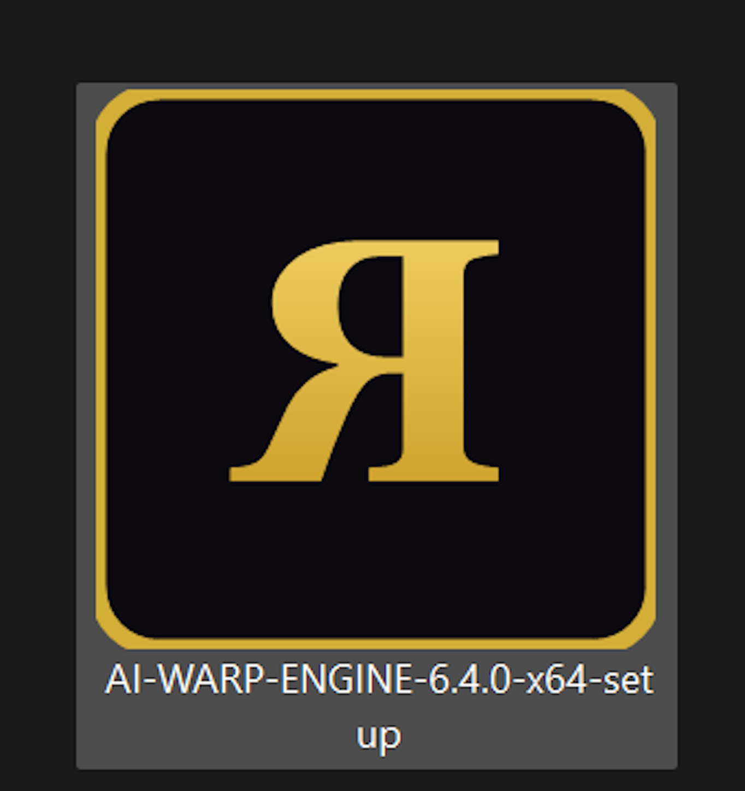

# AI WARP ENGINE - v6.4.37

**A Windows visual synthesizer and audio-reactive media playground.**
Combine live media, generative artwork, 34 glitch voices, 29 warp effects and
audio-driven automation in one Canvas-based performance interface.



## Download and install

**Current local build:** `shell\AI-WARP-ENGINE-6.4.37-x64-setup.exe`.
**FINAL NOVEMBER 2026 RELEASE:** the [v6.4.37 release](https://github.com/TheImortalimp/AI-WARP-ENGINE/releases/tag/v6.4.37)
publishes the browser app and documentation. The Windows installer and app bundle
are **not yet published**: complete corresponding source/build materials for the
bundled GPLv3 FFmpeg build are awaiting [upstream request #254](https://github.com/GyanD/codexffmpeg/issues/254).
See [release notes](RELEASE_NOTES_6.4.37.md) and
[third-party redistribution status](THIRD_PARTY_NOTICES.md).
Daily upstream checks and approval-gated installer publication are configured;
see [Windows release workflow](WINDOWS_RELEASE_WORKFLOW.md).

[Previous published v6.4.36 installer](https://github.com/TheImortalimp/AI-WARP-ENGINE/releases/download/v6.4.36/AI-WARP-ENGINE-6.4.36-x64-setup.exe)

- Windows 10/11 x64 and Microsoft Edge WebView2 are required.
- The .NET runtime and bundled media are included.
- Run the installer, approve Windows UAC, and complete the wizard.
- The default destination is `Desktop\AI WARP ENGINE`, with desktop and Start
  Menu shortcuts and an uninstaller.
- **Elevation is required:** the installer applies system-pointer and
  theme/sound policy hardening. Review [About](ABOUT.md#cursor-and-theme-protection)
  before installing; this is not a visuals-only, no-admin installation.
- The installer is unsigned and may trigger SmartScreen.

Verify downloads against **SHA256SUMS.txt** in the
[release assets](https://github.com/TheImortalimp/AI-WARP-ENGINE/releases/tag/v6.4.37).
The release also includes a matching browser-app ZIP. Extract the entire folder,
including its media, and serve it over localhost rather than opening `file://`.
The browser ZIP omits website-root `home.html` and `index.html` but includes the
app folder's own `index.html`. The documentation ZIP is separate.

## What's fixed in 6.4.37

- Continuous, synchronized FX with smooth mode transitions and frame recovery.
- Offline AVI/unsupported audio-video conversion using bundled FFmpeg.
- Local-only app scripts and hardened navigation, permissions and native bridge boundaries.
- External browsers/new windows blocked; release debugging disabled.
- Top-panel label: **v6.4.37 - Glitch Hardened & FX Fixed**.

See [changelog](CHANGELOG.md) for validation and protection limits.

### Previous startup repair in 6.4.36

The previous release accidentally concatenated the app, showcase and YouTube
LENS documents. Duplicate canvases and controls started competing engines,
hid the initialization artwork and broke normal effect control.

- Restored the animated startup grid/rings and responsive effect playback.
- Restored the dedicated YouTube LENS player.
- Added single-instance JavaScript initialization, dependency/mount validation,
  a five-second configuration timeout and visible runtime/startup errors.
- Kept animation scheduling alive after transient rendering failures and
  restored canvas state after failed voice passes.
- Retained the Windows system-cursor and theme/pointer protections.
- Synchronized the HUD, app, installer and asset versions:
  **v6.4.36 - INIT + FX RESTORED - CURSOR GUARD**.

See [release notes](RELEASE_NOTES_6.4.36.md) and [changelog](CHANGELOG.md).

## Features

| Area | Included |
|------|----------|
| Sources | Generated visuals, local images/video/audio, YouTube URLs/playlists, shared screen/window/tab and microphone |
| Glitch mixer | 17 core voices plus 17 independent `GC#(3)` counterparts; per-voice level, size, depth and locks |
| Warp | 29 effects plus AI ZERO, including liquid, prism, vortex, kaleidoscope, twirl, RGB shift and neon edges |
| R3 overlays | Ghost Protocol: DIA, SPECTRUM, CRT, PLASMA, LED; V-Sync: Scanphasing, Color Harmony, Sharp |
| Audio | Bass/mid/treble/drive analysis, spectrum/waveform displays, microphone and built-in synth grooves |
| Automation | Auto Glitch, Continual Random, Automated Masters, Timed Auto, Soft-Eye and Crescendo |
| Presets | 80 machine presets, saved user presets, cross-fades and protected manual settings |
| Feedback | DROP THE MILK? with 80 original Milkdrop-inspired presets and lockable opacity |
| Output | Full-viewport B&W/Hue treatment and HUD-free Canvas PNG freeze frames |
| Showcase | Four bundled, original RAUM X-R synthesized tracks and artwork-driven visual sequences |

### YouTube and browser limitations

In the Windows app, a supporting **AI WARP LENS** window plays YouTube; the host
streams its rendered frames into the main Canvas and supplies audio analysis
through per-process loopback, with a system-loopback fallback. Switching sources
stops the lens.

A normal browser cannot read cross-origin YouTube iframe pixels. Use local media
or **Share Screen / Window** (`N`) for pixel-based effects and screenshots.
Embedding availability, internet access and codec support remain external
constraints; a fixed engine cannot make blocked YouTube videos playable.

## Quick controls

Start with the animated generated source, enable a mixer voice, and adjust its
level. Press `R` to randomize, `W` to cycle warp, `G` for Ghost, `V` for V-Sync,
`D` for Milkdrop, `Z` to clear voices, `S` for a freeze-frame PNG and `?` for help.
`M` toggles microphone monitoring, `N` shares a display source and `H` hides UI.
The Windows shell uses `F11` for fullscreen and `F5` for reload.

For setup and all controls, see the [user manual](MANUAL.md) and
[engine documentation](ai_warp_engine/README.md).

## Run the browser edition

From the repository root:

```powershell
python -m http.server 8000 --bind 127.0.0.1
```

Open <http://localhost:8000/ai_warp_engine/index.html>.
The aliases `index.html`, `ai_warp_engine.html` and `media_page.html` within the
app folder are identical. The repository-root `index.html` is a separate site
page, not the app entry point. Windows cursor policy enforcement and desktop
LENS capture are host-only features.

## Build and validate

Requires Node.js for tests, the .NET 8 SDK and a complete FFmpeg distribution for the host, and
[NSIS](https://nsis.sourceforge.io/) for the installer.

```powershell
node --test tests\regressions.test.cjs tests\local-media.test.cjs
powershell.exe -NoProfile -ExecutionPolicy Bypass -File shell\build.ps1
Set-Location shell
& "C:\Program Files (x86)\NSIS\makensis.exe" setup.nsi
```

Output: `shell\AI-WARP-ENGINE-6.4.37-x64-setup.exe`.
See [shell build documentation](shell/README.md).

Current source changes add synchronized, gap-free FX composition, 240 ms warp
mode blending, continuous warp phase and last-good-frame recovery for all media
sources. The Windows build also bundles FFmpeg for offline conversion of
unsupported local video/audio, including AVI. Existing release downloads do not
contain these changes; rebuild to use them.

For browser pixel checks, serve the repository over localhost and run in the
app's developer console:
```javascript
await import('/tests/fx-continuity.browser.js');
await runFxContinuityChecks();
```
This checks 29 modes at three strengths, transparent/untreated frames, mode
transitions, scratch-buffer stability, OFF controls and failure recovery.
Native conversion checks can be run with
`dotnet run --project tests\MediaConversion -- "<ffmpeg.exe path>" "<empty fixture directory>"`.
They generate synthetic AVI/AIFF media, verify conversion and cache reuse, and
check original preservation, corruption errors and cancellation.

Validation for the previous 6.4.36 release: 11 dependency-free regression tests passed; browser
checks rendered all 34 voices and exercised all 30 mode selections without
JavaScript errors, including with the injected cursor guard. Windows publish
and NSIS packaging succeeded; all packaged HTML/JS/CSS/JSON matched source.
This is not an end-to-end certification of native capture or machine policies.

## Repository

- [ai_warp_engine/](ai_warp_engine/) - app HTML, JavaScript, CSS, configuration and bundled media.
- [shell/](shell/) - WinForms/WebView2 host, audio capture, cursor guards and NSIS installer.
- [tests/](tests/) - document, JavaScript, startup, render, LENS and version regression checks.
- [ABOUT.md](ABOUT.md) - project overview and protection boundaries.
- [DESCRIPTION.md](DESCRIPTION.md) - short GitHub/project description.

Settings live in `%LOCALAPPDATA%\AI-Warp-Engine\profile`. Optional
`AIWARP_PROFILE` selects a different profile. `AIWARP_DEBUG_PORT` enables local
Chromium remote debugging only in Debug builds; Release builds disallow debugger
environment overrides. Current source also restricts app/LENS navigation, bridge
callers, permissions and external-link launches. This is app-level hardening, not
a physical-input-only guarantee or Defender integration.

## License and credits

The software is dedicated to the public domain under
[CC0 1.0](https://creativecommons.org/publicdomain/zero/1.0/) and
[The Unlicense](https://unlicense.org/); see [license](shell/LICENSE.txt).
The imortalimp.nl site content is CC BY 4.0. Third-party media and dependencies
retain their own rights and terms.

Created by River Lyle Reuveni (Imortalimp), with Arena.ai and GitHub Copilot.
The four original RAUM X-R tracks are dedicated to Stefan Betke (Pole), Daniel
Meteo, Burnt Friedman and Kit Clayton; they use no recordings by those artists
and are not affiliated with them. [Support the original album](https://pole-stefanbetke.bandcamp.com/album/r).
